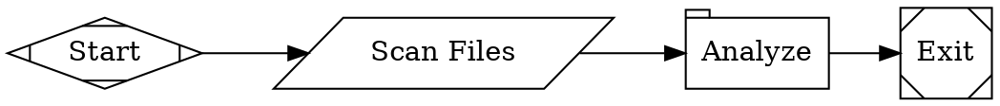

Fabro workflows are written in a subset of the [Graphviz DOT language](https://graphviz.org/doc/info/lang.html) with extensions for agent orchestration. This page is the complete syntax reference. For conceptual introductions, see [Workflows](/core-concepts/workflows) and [Nodes & Stages](/workflows/stages-and-nodes).

## File structure

Every workflow is a `digraph` (directed graph) with a name and a body of statements:



Only `digraph` is supported — `graph` (undirected) and `strict` are not. The graph name is required. Semicolons after statements are optional.

## Comments

```dot
// Line comment — everything to end of line

/* Block comment
   spanning multiple lines */
```

Comments inside quoted strings are preserved as literal text.

## Value types

Attribute values in `[key=value]` blocks can be:

| Type | Syntax | Examples |
|---|---|---|
| String | Double-quoted | `"Run tests"`, `"line1\nline2"` |
| Integer | Bare digits, optional sign | `42`, `-1`, `0` |
| Float | Digits with decimal point | `3.14`, `-0.5`, `.5` |
| Boolean | Keywords | `true`, `false` |
| Duration | Integer with unit suffix | `250ms`, `30s`, `15m`, `2h`, `1d` |
| Bare string | Identifier with hyphens/dots | `claude-sonnet-4-5`, `gpt-5.4` |
| Identifier | Bare word | `LR`, `box`, `Mdiamond` |

**Escape sequences** in quoted strings: `\"`, `\\`, `\n`, `\t`.

**Duration units:** `ms` (milliseconds), `s` (seconds), `m` (minutes), `h` (hours), `d` (days).

## Statements

The body of a digraph can contain these statement types:

### Graph attributes

Set workflow-level configuration:

```dot
// Block syntax
graph [goal="Build a feature", model_stylesheet="* { model: claude-haiku-4-5; }"]

// Declaration syntax
rankdir=LR
```

| Attribute | Type | Description |
|---|---|---|
| `goal` | String | Workflow objective — guides agent behavior |
| `rankdir` | Identifier | Layout direction: `LR` (left-to-right) or `TB` (top-to-bottom) |
| `model_stylesheet` | String | CSS-like rules for model assignment. The root value supports a MiniJinja template with `inputs` and `vars` (see [Model Stylesheets](/workflows/stylesheets)) |
| `default_max_retries` | Integer | Default retry count for all nodes (default: 0) |
| `on_failure` | String | Failed-node policy when no explicit recovery route matches: `route` (default), `exit`, or `succeed` |
| `retry_target` | String | Default node ID to jump to on retry |
| `fallback_retry_target` | String | Fallback retry target if primary target fails |
| `default_fidelity` | String | Default [fidelity level](/execution/context) for all nodes |
| `default_thread` | String | Default thread ID for all nodes |
| `max_node_visits` | Integer | Max visits per node across the run (0 = unlimited) |
| `stall_timeout` | Duration | Timeout for stalled workflows (default: `1800s`, 0 = disabled) |
| `loop_restart_signature_limit` | Integer | Max times the same failure signature can repeat before aborting (default: 3) |

### Node defaults

Apply default attributes to all subsequently declared nodes:

```dot
node [shape=box, timeout="900s"]
```

Defaults are scoped to their enclosing subgraph. Explicit attributes on individual nodes override defaults.

### Edge defaults

Apply default attributes to all subsequently declared edges:

```dot
edge [weight=5]
```

### Node declarations

Declare a node with optional attributes:

```dot
plan [label="Plan", prompt="Create an implementation plan."]
```

**Node identifiers** must start with a letter or underscore, followed by letters, digits, or underscores (e.g. `run_tests`, `gate_1`, `_private`).

Every node used by an edge needs its own declaration. Validation fails when an edge names a node the workflow never declares, because that is nearly always a typo or a rename that missed an edge. The declaration can come before or after the edges that use it, and it can live in a subgraph.

### Edge declarations

Connect nodes with directed edges:

```dot
start -> plan -> implement -> exit
```

Chained edges like `A -> B -> C` expand to individual edges `A -> B` and `B -> C`, all sharing the same attributes.

Edges can have attributes:

```dot
gate -> exit      [label="Pass", condition="outcome=succeeded"]
gate -> implement [label="Fix"]
```

### Subgraphs

Group nodes visually and apply scoped defaults:

```dot
subgraph cluster_impl {
    label = "Implementation"
    node [thread_id="impl", fidelity="full"]

    plan      [label="Plan"]
    implement [label="Implement"]
    review    [label="Review"]
}
```

When a subgraph has a `label`, it is converted to a CSS class name and applied to all nodes within the subgraph (e.g. `"Implementation"` becomes class `implementation`, `"Loop A"` becomes `loop-a`). This enables [stylesheet](/workflows/stylesheets) targeting.

Node and edge defaults declared inside a subgraph are scoped — they don't leak to the outer graph. Edges can cross subgraph boundaries.

## Node types

Fabro uses an explicit `type` attribute to select a node's handler. Without `type`, the `shape` attribute selects the handler. See [Nodes & Stages](/workflows/stages-and-nodes) for detailed documentation of each type.

| Shape | Handler | Purpose |
|---|---|---|
| `Mdiamond` | start | Workflow entry point (exactly one required) |
| `Msquare` | exit | Workflow terminal (exactly one required) |
| `box` (default) | agent | Multi-turn LLM with tool access |
| `tab` | prompt | Single LLM call, no tools |
| `parallelogram` (inferred from `script` when `shape` and `type` are omitted) | command | Execute a shell script |
| `hexagon` | human | Human-in-the-loop decision gate |
| `diamond` | conditional | Route based on conditions |
| `component` | parallel | Fan-out to concurrent branches |
| `tripleoctagon` | parallel.fan_in | Merge parallel branch results |
| `insulator` | wait | Pause for a duration |
| `house` | stack.manager_loop | Sub-workflow orchestration |

The `type` attribute can be set explicitly to override the shape-based mapping and attribute inference.

Start nodes can also be identified by ID (`start` or `Start`). Exit nodes can be identified by ID (`exit`, `Exit`, `end`, or `End`).

### Omitting the shape

The two most common node types don't need a `shape` or `type`. When both are omitted, a node that sets `script` is a command node. Every other node defaults to an agent node:

```dot
plan  [prompt="Plan the work"]      // agent
build [script="cargo build"]        // command
```

An explicit `shape` or `type` always wins. For example, `shape=box` with a `script` is still an agent node, and the `script` has no effect. Setting both `script` and `prompt` on one node is an error because command handlers consume `script`, while LLM handlers consume `prompt`.

Other node types still need their shape, because their attributes don't identify them uniquely. In particular, agent and prompt nodes take the same attributes, so a prompt node needs `shape=tab`.

## Node attributes

### All nodes

| Attribute | Type | Description |
|---|---|---|
| `label` | String | Display name in the graph visualization |
| `shape` | Identifier | Graphviz shape — determines handler type (see table above) |
| `type` | String | Explicit handler type (overrides shape) |
| `class` | String | Classes for [stylesheet](/workflows/stylesheets) targeting. Separate multiple classes with spaces. Commas are also accepted for compatibility. |
| `timeout` | Duration | Execution timeout (e.g. `900s`). An agent's wait for human input does not consume this budget. On a human node, this is the response deadline. |
| `max_visits` | Integer | Max times this node can execute in a run. Overrides the graph-level `max_node_visits` for this node. |
| `on_failure` | String | Failed-node policy for this node: `route`, `exit`, or `succeed`. Overrides the graph-level `on_failure`. See [Node Outcomes](/execution/outcomes#succeed-on-failure). |
| `max_retries` | Integer | Override default retry count |
| `retry_policy` | String | Named preset: `none`, `standard`, `aggressive`, `linear`, `patient` |
| `retry_target` | String | Node ID to jump to on retry |
| `fallback_retry_target` | String | Fallback node ID if primary `retry_target` is unreachable |
| `goal_gate` | Boolean | When `true`, workflow fails if this node didn't finish with `succeeded` or `partially_succeeded`. See [Node Outcomes](/execution/outcomes#goal-gate-interaction). |
| `auto_status` | Boolean | Deprecated alias for `on_failure="succeed"`. Validation warns when it is present. |
| `allow_partial` | Boolean | When `true` and retries are exhausted on a retry-requesting failure, promotes the outcome to `partially_succeeded` instead of `failed`. Default `false`. See [Node Outcomes](/execution/outcomes#allow_partial). |
| `selection` | String | Edge tiebreaking strategy: `deterministic` (default) or `random` (weighted-random). Cannot be combined with conditional edges. |

### Agent and prompt nodes

| Attribute | Type | Description |
|---|---|---|
| `prompt` | String | Task instructions for the LLM. Supports file references with `@path/to/file.md` |
| `reasoning_effort` | String | `low`, `medium`, or `high` (default: `high`) |
| `max_tokens` | Integer | Maximum output tokens |
| `fidelity` | String | How much prior context is passed: `compact`, `full`, `summary:high`, `summary:medium`, `summary:low`, `truncate`. On a node entered directly from a parallel fork, this is overridden by the fork-to-branch edge; explicit `full` degrades to `summary:high`. |
| `thread_id` | String | Groups nodes into a shared conversation thread. Inert when the node is entered directly from a parallel fork. |
| `model` | String | Explicit model ID (overrides stylesheet) |
| `provider` | String | Explicit provider name (overrides stylesheet). Auto-inferred from the model catalog when omitted. |
| `project_memory` | Boolean | When `true` (default), prompt nodes discover and include project docs (`AGENTS.md`, `CLAUDE.md`, etc.) as a system prompt. Set to `false` to disable. |
| `output_schema` | String | Optional structured output validation. Use `routing` for Fabro's built-in routing directive schema, `@path/to/schema.json` for a JSON Schema file, or an inline JSON Schema object string. Supported on agent, prompt, and command nodes. |
| `output_retries` | Integer | Corrective structured-output turns inside the same prompt conversation or agent session. Default `2`; `0` validates once and fails without repair; negative values are treated as `0`. Separate from `max_retries`. |
| `backend` | String | Agent execution backend: `api` (default) or `acp`. `api` runs Fabro's tool loop through provider APIs; `acp` runs an Agent Client Protocol stdio agent inside the active sandbox. Prompt nodes are API-only. See [Agents — Backends](/core-concepts/agents#backends). |
| `acp.command` | String | Shell command for nodes with `backend="acp"`. Mutually exclusive with `acp.config`. The value is always parsed as a command string, not JSON. |
| `acp.config` | String | JSON stdio ACP config for nodes with `backend="acp"`. Mutually exclusive with `acp.command`. |

#### Structured output validation

`output_schema` opts an agent, prompt, or command node into strict JSON validation:

```dot
review [
  shape=tab,
  output_schema="routing",
  output_retries=2
]

audit [
  shape=tab,
  output_schema="@schemas/audit-result.schema.json",
  output_retries=2
]
```

- `output_schema="routing"` requires a JSON object with at least one recognized routing field: `preferred_next_label`, `outcome`, `failure_reason`, `suggested_next_ids`, or `context_updates`.
- `output_schema="@schemas/audit-result.schema.json"` loads a JSON Schema file using workflow file-reference rules and validates the final JSON object in the response text. Inline JSON Schema object strings are also accepted, but file references are usually easier to read.
- API-backed agent nodes receive the resolved output contract in their task instructions. The contract applies only to the final response, so the agent can still use tools and send intermediate progress while it works.
- On validation failure, Fabro sends validation feedback to the same active context before failing: prompt nodes keep the prior assistant response in the message list, and API-backed agent nodes repair in the same live session.
- `output_retries` defaults to `2` and controls only these corrective structured-output turns. Negative values are treated as `0`. It is not the same as `max_retries` and does not consume workflow retry attempts.
- Custom schema output is stored in context at `output.{node_id}`. Routing schema output updates routing fields and any `context_updates`.
- Agent routing fallbacks still apply to `output_schema="routing"`: response text first, then `status.json`, then the last file touched by the agent. The last-file fallback only accepts `.json` and `.md` files (case-insensitive) whose final JSON object contains the routing directive; only whitespace may follow it. Custom schemas and prompt nodes validate response text only.
- Command nodes validate merged stdout and stderr only after the script exits with code `0`, using the same object selection as agents and prompts: custom schemas validate the last JSON object, and `routing` validates the last JSON object containing a recognized routing field. Print the intended JSON object last. A validation error is a deterministic, non-retryable failure with no repair turn or `status.json` fallback. `output_retries`, `retry_policy`, and `max_retries` do not retry it. Nonzero exits retain normal command failure behavior without schema validation.
- For commands, custom schema output is stored at `output.{node_id}`; edge conditions cannot traverse into its fields. The `routing` schema applies routing fields and merges `context_updates` into flat context keys, which conditions can read (for example, `context.kept_count`).
- `backend="acp"` with `output_schema` is unsupported in this release.

### Command nodes

| Attribute | Type | Description |
|---|---|---|
| `script` | String | Shell command to execute (required). Its presence infers a command node when `shape` and `type` are omitted. |
| `language` | String | `"shell"` (default) or `"python"` |
| `stdin_source` | String | Flat runtime context key to pass to standard input. `context.NAME` first checks that exact key, then falls back to `NAME`. Strings are passed unchanged; other values use compact JSON. No newline is added. |
| `output_schema` | String | Optional structured output validation. Accepts `routing`, `@path/to/schema.json`, or an inline JSON Schema object string. See [Structured output validation](#structured-output-validation). |

### Parallel (fan-out) nodes

| Attribute | Type | Description |
|---|---|---|
| `max_parallel` | Integer | Maximum concurrent branches (default: 4). The node always waits for every branch. |
| `for_each` | String | Flat runtime context key containing a JSON array. Runs the node's single agent or prompt target once per item. `context.items` first checks that exact key, then falls back to `items`. |

For the first node in each branch, `fidelity` resolves from the fork-to-branch edge, then the branch node; without either, the fork preamble is inherited unchanged. Branch-specific preambles are rendered before fan-out from the fork's context snapshot. Concurrent branches cannot share sessions, so explicit branch `full` becomes `summary:high`, and branch-level `thread_id` is inert.

When `for_each` is set, the parallel node must have exactly one outgoing edge,
and its target must be an agent or prompt node. Fabro resolves the source as an
inline array or a managed `blob://` or `file://` JSON artifact, then clones the
target once per item. Nested `for_each` is not supported.

Each clone receives the target's normal prompt followed by the item as pretty
JSON inside a fresh `<untrusted-{16 lowercase hex}>` fence with a matching
closing tag, plus a fixed notice that the content is data, not instructions.
There is no item interpolation syntax. The fence prevents an item from closing
its own data block, but it does not restrict an agent's tools; workflow authors
must give the target only the tool access appropriate for untrusted item data.

A source array above 1000 items fails the parallel stage before any branch
starts. Filter the array in the node that produces it, or split the work across
runs.

Dynamic results retain input order. Each result uses the template target ID and
adds a zero-based `index` plus `item_label`, derived from the item's `name`,
then `label`, then its index. An empty array succeeds and proceeds directly to
the target's fan-in node without executing the unparameterized target.

### Wait nodes

| Attribute | Type | Description |
|---|---|---|
| `duration` | Duration | How long to pause (required). E.g. `"30s"`, `"2m"` |

### Human nodes

| Attribute | Type | Description |
|---|---|---|
| `question_type` | String | Optional interview question type override: `yes_no`, `confirmation`, `multiple_choice`, `multi_select`, or `freeform`. Defaults to `freeform` when the gate only has a freeform edge; otherwise defaults to `multiple_choice`. |
| `review_target` | Boolean | When `true`, read and validate the typed `review_target` context value, then present it as the primary link in the question. Fabro generates the question text, so the node's `label` is not used. See [Review targets](/workflows/human-in-the-loop#review-targets). |
| `human.default_choice` | String | Target node to use when the question times out. |

### Manager loop (sub-workflow) nodes

| Attribute | Type | Description |
|---|---|---|
| `stack.child_workflow` | String | Path to child workflow `.fabro` file (required unless inline source given) |
| `stack.child_dot_source` | String | Inline DOT source for the child workflow (alternative to file path) |
| `manager.poll_interval` | Duration | How often the manager checks the child workflow (default: `45s`) |
| `manager.max_cycles` | Integer | Maximum polling cycles before timeout (default: 1000) |
| `manager.stop_condition` | String | Condition expression — when true, the child run is stopped early |

## Edge attributes

| Attribute | Type | Description |
|---|---|---|
| `label` | String | Display text; also used for human gate option matching |
| `condition` | String | Boolean expression for conditional routing (see below) |
| `weight` | Integer | Priority for tiebreaking (higher wins, default: 0) |
| `fidelity` | String | Override fidelity level for this transition. On a fork-to-branch edge, takes precedence over the branch node; explicit `full` degrades to `summary:high`. |
| `thread_id` | String | Override thread ID for this transition. Inert on fork-to-branch edges. |
| `loop_restart` | Boolean | Restart the workflow from this edge's target when taken: stage history and retry counts clear and the context resets to empty (visit counts are kept). Failed outcomes may only take it for `transient_infra` failures — see [Failures](/execution/failures#loop-restart-edges) |
| `freeform` | Boolean | When `true` on a human-gate edge, accept free-text input instead of fixed choices |

## Condition expressions

Edge conditions are boolean expressions evaluated against the stage outcome and run context. See [Transitions](/workflows/transitions) for the full routing logic.

### Grammar

```
Expr       ::= OrExpr
OrExpr     ::= AndExpr ('||' AndExpr)*
AndExpr    ::= UnaryExpr ('&&' UnaryExpr)*
UnaryExpr  ::= '!' UnaryExpr | Clause
Clause     ::= Key Op Value | Key        (bare key = truthy check)
Value      ::= BareWord | '"' QuotedString '"'
Op         ::= '=' | '!=' | '>' | '<' | '>=' | '<='
             | 'contains' | 'matches'
```

### Keys

| Key | Resolves to |
|---|---|
| `outcome` | Stage outcome: `succeeded`, `failed`, `partially_succeeded`, or `skipped`. See [Node Outcomes](/execution/outcomes#outcome-in-edge-conditions). |
| `preferred_label` | Label selected by a human gate or LLM routing directive |
| `context.KEY` | Value from the run context |
| `KEY` | Shorthand for context lookup (without the `context.` prefix) |

### Operators

| Operator | Example | Description |
|---|---|---|
| `=` | `outcome=succeeded` | Equality |
| `!=` | `outcome!=failed` | Inequality |
| `>` | `context.score > 80` | Greater than (numeric) |
| `<` | `context.count < 5` | Less than (numeric) |
| `>=` | `context.score >= 80` | Greater than or equal |
| `<=` | `context.count <= 10` | Less than or equal |
| `contains` | `context.message contains error` | Substring match or array membership |
| `matches` | `context.version matches ^v\d+` | Regular expression match |
| `&&` | `a=1 && b=2` | Logical AND (binds tighter than `\|\|`) |
| `\|\|` | `a=1 \|\| b=2` | Logical OR |
| `!` | `!outcome=failed` | Logical NOT |

A bare key with no operator is a **truthiness check** — it passes if the value is non-empty, not `"false"`, and not `"0"`.

### Examples

```dot
// Simple outcome check
gate -> exit [condition="outcome=succeeded"]

// Compound condition
gate -> deploy [condition="outcome=succeeded && context.tests_passed=true"]

// Either outcome
gate -> proceed [condition="outcome=succeeded || outcome=partially_succeeded"]

// Negation
gate -> retry [condition="!outcome=succeeded"]

// Numeric comparison
gate -> fast_path [condition="context.score > 80"]

// Substring search
gate -> alert [condition="context.log contains error"]

// Regex match
gate -> v2 [condition="context.version matches ^v2\\."]

// Unconditional fallback (no condition attribute)
gate -> slow_path
```

## Prompt and schema file references

Instead of inlining long prompts or JSON Schemas, reference an external file:

```dot
simplify [label="Simplify", prompt="@prompts/simplify.md"]
audit [shape=tab, output_schema="@schemas/audit-result.schema.json"]
```

The `@` prefix tells Fabro to load the referenced file relative to the workflow file. Keep supporting files inside the workflow bundle. Bundled child workflows cannot resolve `..` to reach a parent's files; place their shared inputs beside them instead:

```dot
// In shared/testing.fabro, this refers to shared/ticket.md.
check [prompt="@ticket.md"]
```

Untracked `@file` references (files not committed to git) are inlined into the Graphviz source at prepare time, so they work even inside sandboxes that only see the git tree.

Fabro validates `@file` references at parse time — if the referenced file does not exist, validation fails with a clear error pointing to the bad reference.

## Validation

Fabro validates workflows at parse time and reports diagnostics. Key rules:

- Exactly one start node and one exit node
- All nodes reachable from start
- No incoming edges to start, no outgoing edges from exit
- Edge targets reference existing nodes
- Condition expressions parse correctly
- Stylesheet syntax is valid
- LLM nodes (agent, prompt) have a `prompt` attribute
- `@file` references point to existing files
- Conditional nodes have multiple outgoing edges with conditions
- Retry targets reference existing nodes
- Goal gates have retry configuration
- `thread_id` requires `fidelity="full"` (session reuse depends on full fidelity)
- Known handler types only

## Complete example

```dot title="implement-feature.fabro"
digraph ImplementFeature {
    graph [
        goal="Implement a feature with tests and code review",
        model_stylesheet="
            *        { model: claude-haiku-4-5;reasoning_effort: low; }
            .coding  { model: claude-sonnet-4-5;reasoning_effort: high; }
            #review  { model: claude-sonnet-4-5;reasoning_effort: high; }
        "
    ]
    rankdir=LR

    start [shape=Mdiamond, label="Start"]
    exit  [shape=Msquare, label="Exit"]

    // Planning phase
    plan [label="Plan", shape=tab, prompt="Create a detailed implementation plan for: {{ goal }}"]

    // Human approval
    approve [shape=hexagon, label="Approve Plan"]

    // Implementation (threaded for context continuity)
    subgraph cluster_impl {
        label = "Implementation"
        node [thread_id="impl", fidelity="full"]
        implement [label="Implement", class="coding", prompt="Implement the approved plan."]
        test      [label="Write Tests", class="coding", prompt="Write comprehensive tests."]
    }

    // Validation
    validate [label="Run Tests", shape=parallelogram, script="cargo test 2>&1 || true"]
    gate     [shape=diamond, label="Tests passing?"]

    // Review
    review [label="Code Review", shape=tab, prompt="Review the implementation for correctness."]

    // Wiring
    start -> plan -> approve

    approve -> implement [label="[A] Approve"]
    approve -> plan      [label="[R] Revise"]

    implement -> test -> validate -> gate

    gate -> review    [label="Pass", condition="outcome=succeeded"]
    gate -> implement [label="Fix"]

    review -> exit
}
```


